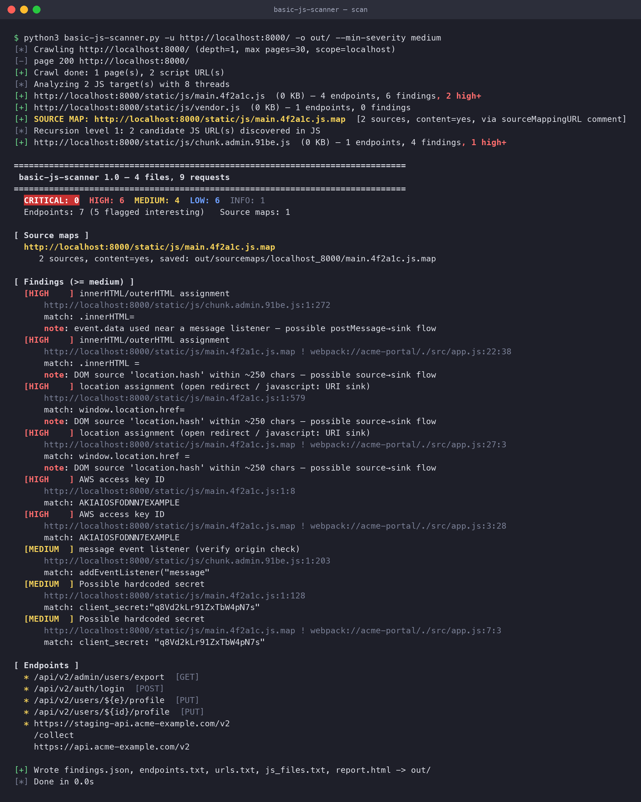
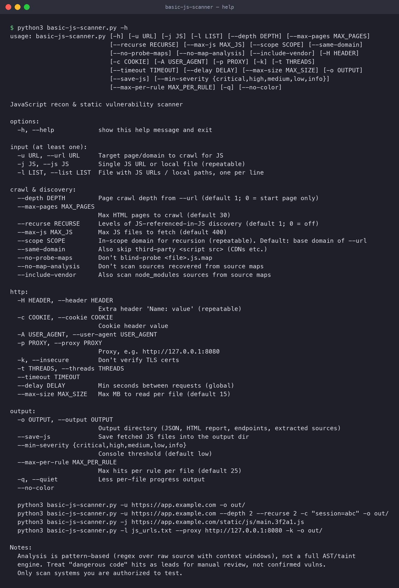

# basic-js-scanner.py

A JavaScript recon and static analysis scanner for web app pentests.

Point it at a site and it collects the client-side JavaScript, then pulls out what the frontend gives away: API endpoints, hardcoded secrets, exposed source maps, and dangerous DOM sinks. If it finds a source map, it recovers the original source code and scans that too.



## Use cases

- **Mapping the API.** Find the endpoints the frontend calls, with the HTTP method when it can be inferred, before you start testing. Feed `endpoints.txt` into Burp, ffuf, or nuclei.
- **Leaked secrets.** Cloud keys, API tokens, JWTs, webhooks, and connection strings that ended up in a production bundle.
- **Source map exposure.** A public `.js.map` with `sourcesContent` hands you the original, unminified source, including comments and file paths. That's a finding by itself, and the recovered source is much easier to review.
- **DOM XSS and client-side bugs.** Flags `innerHTML`, `eval`, `postMessage` listeners, open-redirect sinks, and framework escape hatches, and notes when a DOM source like `location.hash` is nearby.
- **Hidden routes.** Follows webpack chunk maps, Next.js build manifests, and dynamic imports to find JS that never gets loaded on the page you started from (admin panels, feature-flagged code).

## Install

Python 3.8+ and `requests`.

```bash
git clone https://github.com/kampji/basic-js-scanner.git
cd basic-js-scanner
pip install requests
```

## Usage

There are three ways to give it input, and you can combine them:

```bash
python3 basic-js-scanner.py -u https://app.example.com -o out/                # crawl a site for JS
python3 basic-js-scanner.py -j https://app.example.com/static/js/main.js      # one JS file (URL or local path)
python3 basic-js-scanner.py -l js_urls.txt -o out/                            # a list of JS URLs / local files
```

Common options:

```bash
# authenticated crawl, deeper page and chunk discovery
python3 basic-js-scanner.py -u https://app.example.com --depth 2 --recurse 2 -c "session=abc" -o out/

# through Burp, ignoring TLS errors
python3 basic-js-scanner.py -l js_urls.txt --proxy http://127.0.0.1:8080 -k -o out/

# only show medium and above in the console
python3 basic-js-scanner.py -u https://app.example.com --min-severity medium
```



### What it sends

Everything is a plain GET, the same requests a browser would make loading the site.

| Step | Requests |
|---|---|
| Crawl (`-u`) | The start page, plus linked same-scope pages up to `--depth` (default 1) and `--max-pages` (default 30). |
| JS files | Each `<script src>`, preload, and inline script found, up to `--max-js` (default 400). |
| Recursion | JS files referenced from inside other JS (chunks, manifests, imports), up to `--recurse` levels (default 1). Limited to `--scope` (default: the base domain of `-u`). |
| Source maps | Any map named by a `sourceMappingURL` comment or `SourceMap` header, plus a blind `<file>.js.map` probe for each JS file. Turn the probe off with `--no-probe-maps`. |

Use `--delay` to slow it down and `-t` to change the thread count (default 8).

## What it checks

**Endpoints and URLs**
- API paths and full URLs from `fetch`, `axios`, `XMLHttpRequest`, jQuery, and string literals
- HTTP method when it can be inferred from the call
- Endpoints with interesting keywords (admin, auth, export, upload, graphql, swagger, `/api/`, and so on) are starred

**Secrets**
- Cloud: AWS access keys and secret keys, Azure connection strings and SAS tokens, GCP service accounts, Google API keys and OAuth secrets
- Tokens: GitHub, GitLab, Slack, Stripe, SendGrid, Twilio, Mailgun, OpenAI, Anthropic, npm, Shopify, Square
- Webhooks: Slack, Microsoft Teams, Discord
- JWTs (decoded to confirm), private keys, credentials in URLs, hardcoded `Authorization` headers
- Generic `apiKey` / `secret` / `password` assignments, filtered by entropy and placeholder checks

**Infrastructure**
- S3, Azure Blob, GCS, and Firebase references
- Private IP addresses, internal or non-prod hostnames (dev, staging, uat), localhost

**Dangerous code**
- DOM XSS sinks: `innerHTML`, `outerHTML`, `insertAdjacentHTML`, `document.write`, `srcdoc`, jQuery HTML methods
- Script execution: `eval`, `new Function`, string `setTimeout` / `setInterval`
- Framework escape hatches: React `dangerouslySetInnerHTML`, Vue `v-html`, Angular `bypassSecurityTrust*`
- `postMessage` listeners (check the origin) and `postMessage(..., "*")`
- Open-redirect sinks: `location` assignment, `window.open`
- Prototype pollution patterns, `document.domain` changes
- Auth tokens stored in `localStorage` / `sessionStorage`
- Debug flags, GraphQL introspection queries, client-side admin/role checks

Sinks get bumped to HIGH when a DOM source (`location.hash`, `document.referrer`, `event.data`, etc.) shows up close by, and dropped to INFO when the argument is a plain string literal (e.g. `location.href = "/home"`).

**Source maps**
- Downloads every map it finds and extracts the original files from `sourcesContent`
- Scans the recovered source (skipping `node_modules` unless you pass `--include-vendor`)
- Findings in recovered source point to the original file and line, e.g. `main.js.map ! webpack://app/./src/api.js:22:38`

## Output

The console shows a summary, source maps, findings, and endpoints. With `-o out/` you also get:

| File | Contents |
|---|---|
| `findings.json` | Everything, machine-readable |
| `report.html` | A standalone HTML report you can open in a browser |
| `endpoints.txt` | All endpoints and paths, one per line |
| `urls.txt` | Full URLs only |
| `js_files.txt` | Every JS file that was fetched |
| `sourcemaps/` | Downloaded maps and the source files recovered from them |

Add `--save-js` to also keep a copy of every JS file.

## Limitations

This is pattern matching over raw source, not a full AST or taint engine. Treat findings as leads for manual review, not confirmed vulnerabilities:

- A sink near a DOM source isn't proof the source reaches the sink. Read the code.
- The same issue often shows up twice: once in the minified bundle and once in the recovered source.
- Some keys are public by design (Google Maps keys, Stripe publishable keys, Firebase config). Check what they can actually do before reporting them.
- Code that is built at runtime or heavily obfuscated will slip past regexes.

## Disclaimer

Only scan systems you are authorized to test.
